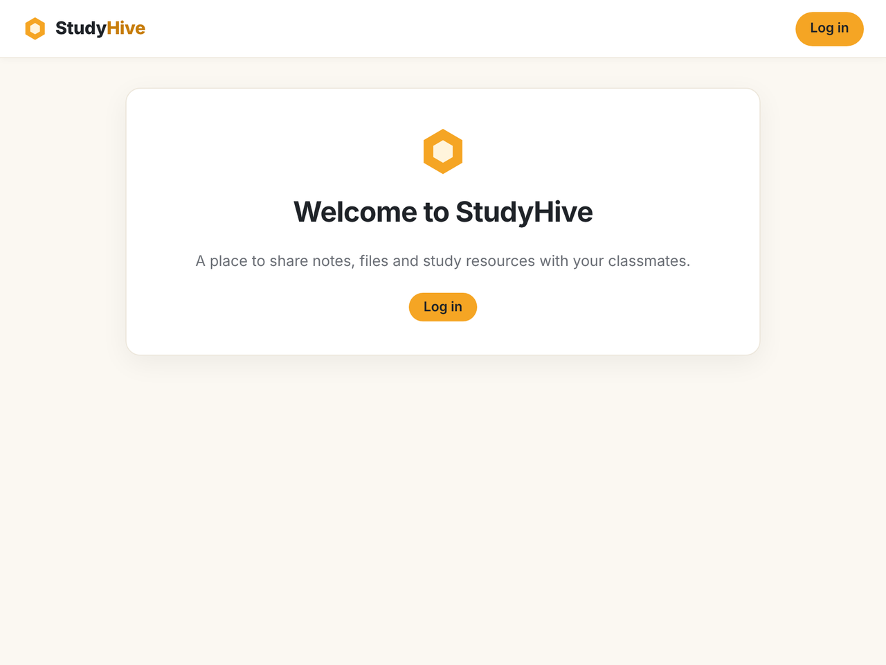
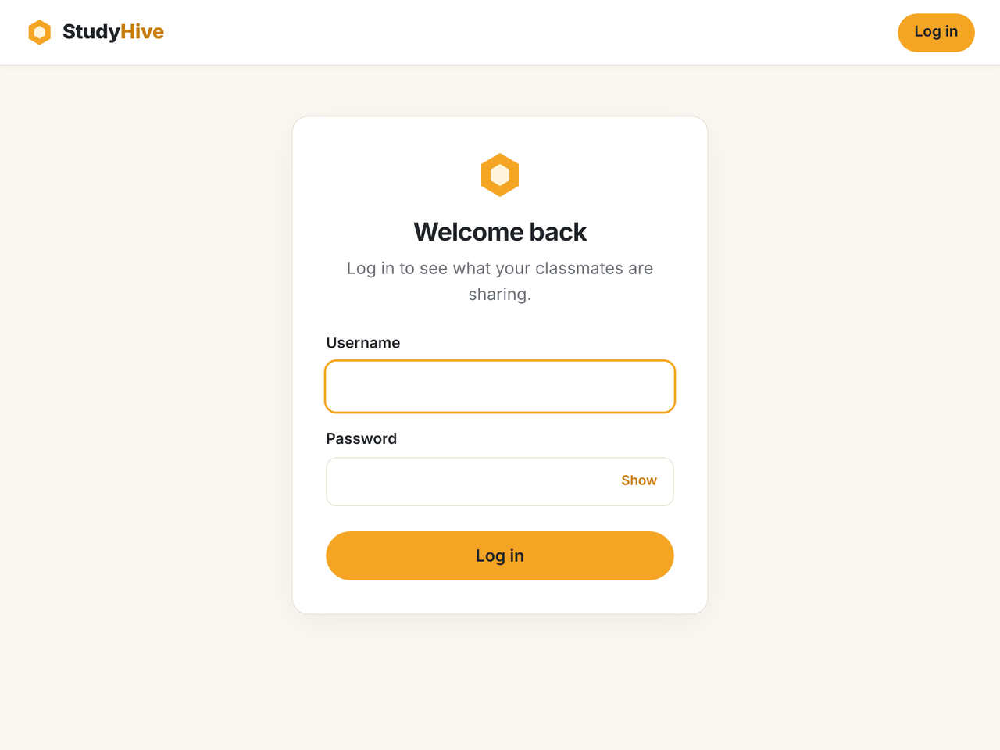
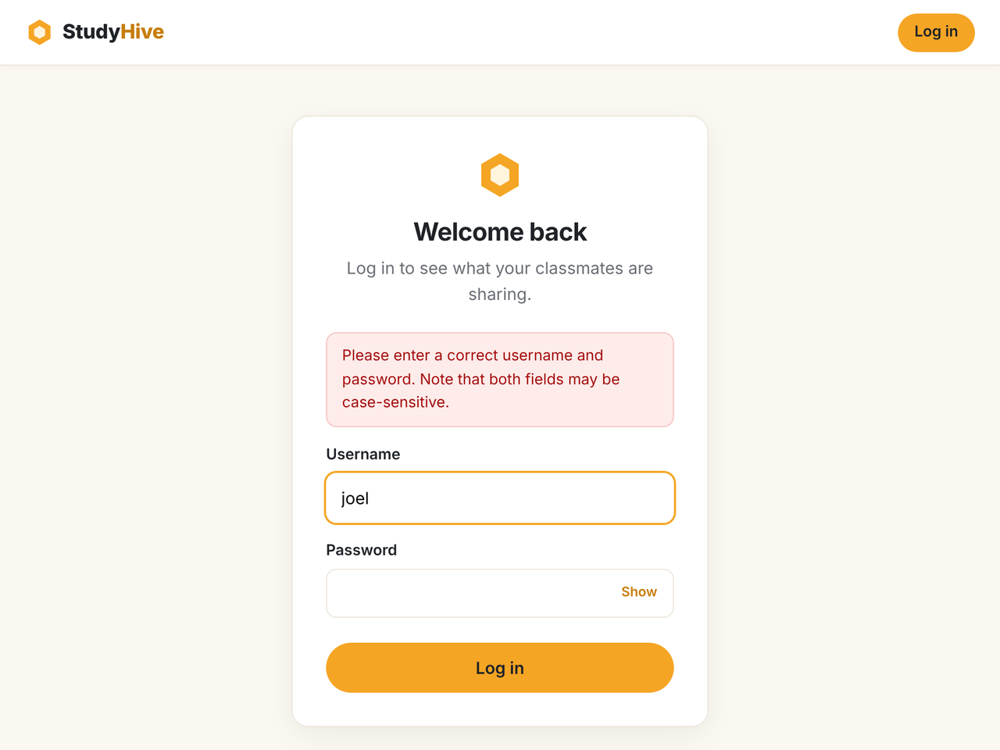
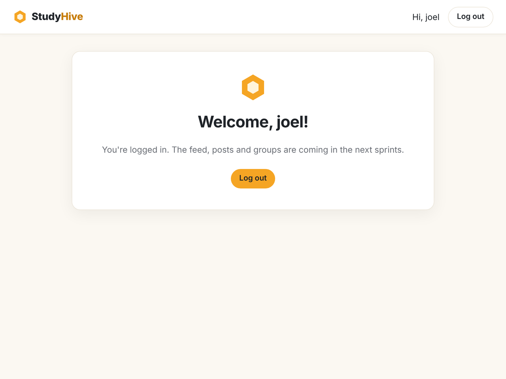

# StudyHive
An app where students can share notes, files and study resources with each other.


Description: 
Study material kinda gets lost in group chats and random cloud folders. StudyHive will give it all a home. Users can
follow classmates, join course groups and share notes, PDF's and links in a feed where others can comment, like 
and save them. 

Agile planning:

We agreed to use Scrum with 2 week sprints and keeping track of tasks via discord and github project board. 

Sprints will look like this with goals and dates attached >>> .... (exact dates are subject to change)
----------------------------------------------------------------------------
Sprints:

Sprint 0 (Oct 19 – Oct 23): Project idea, README, GitHub repo and Django setup

Sprint 1 (Oct 26 – Nov 6): Sign up, login, profiles and posting (stories 1–3)

Sprint 2 (Nov 9 – Nov 20): Following, groups, post visibility and the feed (stories 4–7)

Sprint 3 (Nov 23 – Dec 4): Comments, likes and search (stories 8–9)

Sprint 4 (Dec 7 – Dec 11): Testing, bug fixes and final presentation


----------------------------------------------------------------------------
## Prototype: Log in & Log out (Sprint 1)

Screens from the working Django app. Full slides: [StudyHive-Login-Prototype.pptx](docs/prototype/StudyHive-Login-Prototype.pptx) (click it, then **Download raw file**).

**How it works:** Home page → Log in → Django checks the username and password → Welcome page → Log out → back to the home page. A wrong password keeps you on the login page with an error.

| 1. Home page (logged out) | 2. Login page |
|---|---|
|  |  |
| **3. Wrong password** | **4. Logged in** |
|  |  |

| Page | Address |
|---|---|
| Home | `/` |
| Log in | `/accounts/login/` |
| Log out | `/accounts/logout/` (logs out, then goes back to `/`) |
| Admin (create accounts for now) | `/admin/` |

### Run it locally

```
pip install -r requirements.txt
python manage.py migrate
python manage.py createsuperuser
python manage.py runserver
```

Then open http://127.0.0.1:8000 and log in with the account you just made.
